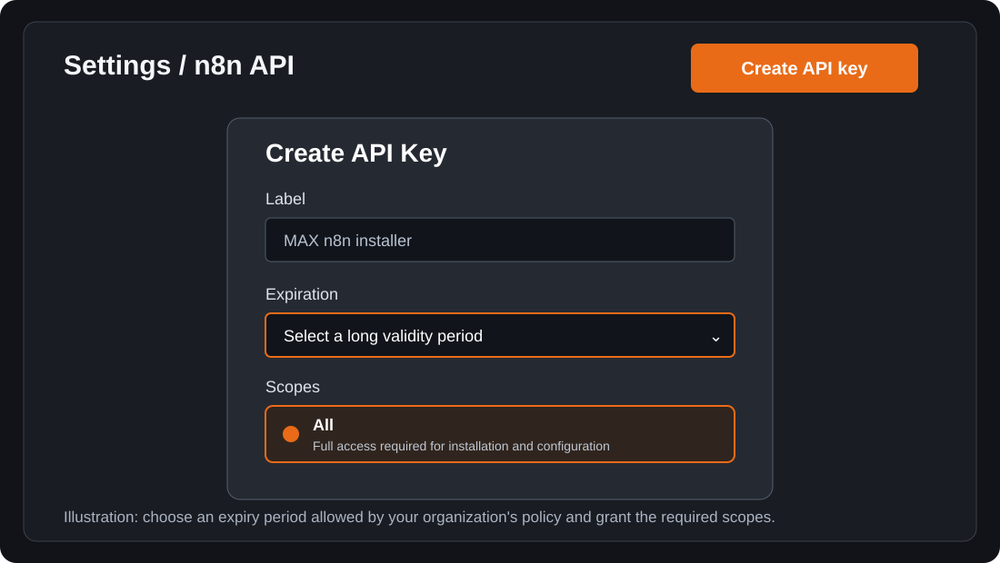
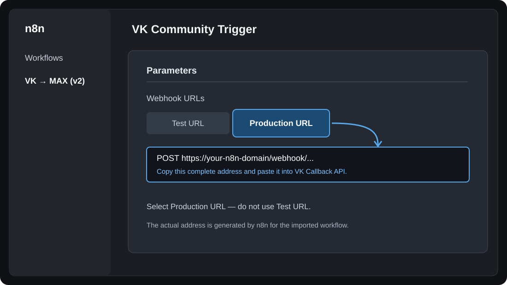
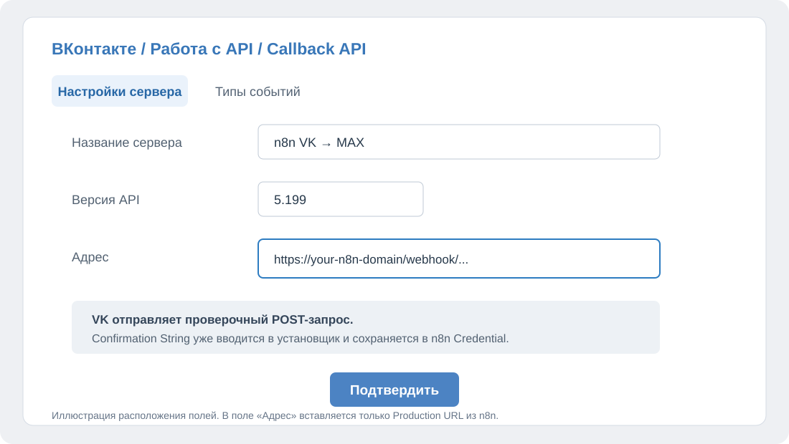
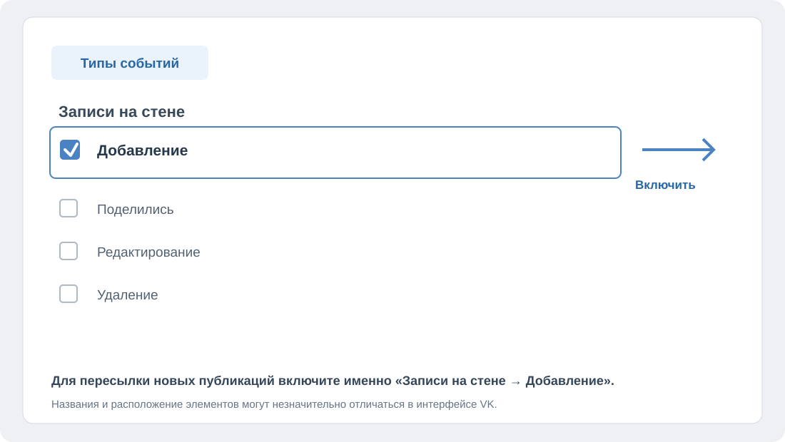

# Полное руководство администратора
## MAX + n8n v2 — установка модулей СЭМД и VK → MAX

Это руководство предназначено для администратора, который устанавливает систему на сервере Ubuntu и впервые работает с n8n, MAX и Callback API ВКонтакте.

## 1. Что устанавливается

Платформа n8n общая для двух модулей:

| Модуль | Назначение |
|---|---|
| **СЭМД** | Формирование отчётов о неподписанных СЭМД и отправка уведомлений сотрудникам через MAX. |
| **VK → MAX** | Автоматическая пересылка новых публикаций сообщества ВКонтакте в групповой чат MAX: текст, фотографии и видео. |

При запуске установщик предложит выбрать:

1. Только СЭМД.
2. Только VK → MAX.
3. СЭМД + VK → MAX.

Если выбран один модуль, установщик запросит только относящиеся к нему настройки. Если выбраны оба, сначала появится блок **«МОДУЛЬ 1 ИЗ 2 — СЭМД»**, затем **«МОДУЛЬ 2 ИЗ 2 — VK → MAX»**. Название модуля будет указано и перед каждым запросом данных. Такая же нумерация применяется при добавлении новых модулей.

## 2. Что необходимо подготовить

### Для сервера

- Ubuntu Server 22.04 LTS или 24.04 LTS.
- Подключение к серверу по SSH.
- Доступ сервера в интернет.
- Для новой установки: домен, направленный DNS A-записью на публичный IP сервера; входящие TCP-порты 80 и 443 должны быть доступны.
- Для существующей установки: работающий n8n версии **2.42.6**.

### Для модуля СЭМД

- Адрес или IP SQL Server и TCP-порт (обычно 1433).
- Имя базы данных МИС.
- SQL-логин и пароль с необходимыми правами.
- Токен MAX-бота.
- При необходимости — ID группового чата или пользователя MAX для общего отчёта.

Структура таблиц МИС должна соответствовать структуре, используемой в workflow СЭМД.

### Для модуля VK → MAX

- Токен сообщества ВКонтакте.
- Строка подтверждения Callback API (Confirmation String), заданная в настройках сообщества VK.
- Токен MAX-бота.
- Числовой ID **группового чата MAX**.
- MAX-бот должен быть добавлен в этот групповой чат и назначен **администратором**. До запуска установки проверьте его права в настройках участников чата.

Личные ID пользователей для модуля VK → MAX не используются.

## 3. Запуск установщика

Подключитесь к серверу по SSH и выполните команды:

```bash
sudo apt update
sudo apt install -y git screen
sudo git clone https://github.com/nesterovichvmir/MAX-n8n-install.git /opt/MAX-n8n-install
sudo screen -S max-install bash /opt/MAX-n8n-install/v2/install.sh
```

Установка запускается внутри сеанса `screen`. Это позволяет ей продолжиться, даже если SSH/PuTTY отключится.

- Временно отсоединиться от сеанса: нажмите **Ctrl+A**, затем **D**.
- Вернуться к установке: выполните `sudo screen -r max-install`.

### Выбор модулей

В меню выберите нужный вариант:

- **1** — только СЭМД;
- **2** — только VK → MAX;
- **3** — оба модуля.

Если n8n уже установлен, установщик обнаружит его и предложит добавить выбранные модули в существующую систему. При обнаружении публичного URL n8n он использует его автоматически.

Установщик создаёт резервную копию данных существующего n8n перед внесением изменений. Если обнаружена неподдерживаемая версия n8n или неоднозначная конфигурация, установка будет остановлена.

## 4. Создание n8n API Key

Для настройки n8n установщику нужен API Key.

При новой установке дождитесь запуска n8n, откройте его HTTPS-адрес в браузере и создайте учётную запись Owner. Затем:

1. Откройте **Settings → n8n API**.
2. Нажмите **Create an API key**.
3. Укажите понятное название ключа, например `MAX n8n installer`.
4. В поле **Expiration** выберите срок действия. Рекомендуется выбрать длительный срок, допустимый правилами вашей организации. После истечения срока ключ перестанет работать.
5. Для **Scopes** выберите **All**. Установщику нужны права на создание и настройку Credentials, workflow, community packages и Data Tables.
6. Нажмите **Save** и сразу скопируйте полный ключ.
7. Вернитесь в терминал и вставьте ключ в запрос установщика. Ввод скрытый — символы на экране не отображаются.

Установщик сохраняет API Key в защищённом файле `/root/.n8n-api-key` с правами доступа только для root. При последующих запусках действующий сохранённый ключ используется автоматически. Если ключ истёк, создайте новый в n8n и обновите сохранённый ключ.

<figure>

<figcaption>Создание API Key: название, срок действия и права доступа.</figcaption>
</figure>

## 5. Модуль СЭМД

Этот раздел нужен, если при выборе установщика был выбран модуль СЭМД.

Перед вводом параметров установщик покажет заголовок **«МОДУЛЬ — СЭМД»**. Все последующие запросы будут помечены `[СЭМД]`.

### Какие данные запросит установщик

1. **Имя/IP SQL Server** — адрес сервера, на котором находится база МИС.
2. **TCP-порт SQL Server** — обычно `1433`.
3. **База данных МИС** — точное имя базы.
4. **SQL логин** и **SQL пароль** — учётная запись для подключения к базе.
5. **Использовать TLS** — выберите `true` или `false` в соответствии с настройками SQL Server.
6. **Разрешить недоверенный сертификат SQL** — включайте только если это требуется конфигурацией SQL Server.
7. **Токен MAX-бота СЭМД**.
8. **Общий отчёт** — выберите один режим:
   - `none` — общий отчёт не отправляется;
   - `chat` — общий отчёт отправляется в групповой чат MAX;
   - `user` — общий отчёт отправляется ответственному пользователю MAX.

Если выбран режим `chat` или `user`, установщик запросит соответствующий числовой ID. Для режима `chat` укажите ID группового чата; для режима `user` — ID пользователя. Если общий отчёт не нужен, выберите `none`.

### Таблица получателей

Установщик создаёт или проверяет в n8n Data Table с именем `report_recipients`. В ней предусмотрены столбцы:

- `fio` — ФИО сотрудника;
- `max_user_id` — ID пользователя MAX.

После установки откройте в n8n раздел **Data Tables**, найдите `report_recipients` и вручную заполните столбец `fio` ФИО сотрудников в соответствии с данными МИС. Столбец `max_user_id` вручную заполнять не нужно: бот получает ID пользователя автоматически при регистрации сотрудника в MAX.

## 6. Модуль VK → MAX

Этот раздел нужен, если выбран модуль VK → MAX.

### 6.1. Подготовка MAX

1. Откройте нужный групповой чат MAX.
2. Добавьте в него MAX-бота, токен которого будет указан при установке.
3. Назначьте бота **администратором группового чата**.
4. Скопируйте числовой ID этого группового чата.

Модуль отправляет публикации только в групповой чат. Личные сообщения пользователям не используются.

### 6.2. Какие данные запросит установщик

В терминале появится заголовок **«МОДУЛЬ — VK → MAX»**. Запросы будут помечены `[VK → MAX]`.

Установщик запросит:

1. **Токен сообщества VK** — ввод скрытый.
2. **Токен MAX-бота** — ввод скрытый.
3. **Числовой ID группового чата MAX** — укажите ID чата, в который добавлен бот.
4. **Строка подтверждения Callback API VK** — скопируйте значение Confirmation String из настроек Callback API сообщества VK и вставьте именно в этот запрос установщика. Ввод скрытый.
5. **Секретный ключ Callback API VK** — укажите его, если он задан в настройках VK; если не задан, оставьте поле пустым.

Установщик автоматически создаёт в n8n Credential **V2 - VK Community** и записывает туда токен сообщества, версию API 5.199 и введённую Confirmation String. Вручную открывать Credential и переносить туда строку не требуется.

Для отправки сообщений в MAX создаётся отдельный Credential **V2 - MAX Header Auth (VK)**. Для обработки видео автоматически подготавливаются SSH-доступ и standalone-версия `yt-dlp` на сервере.

### 6.3. Скопировать Production URL в n8n

После завершения установки:

1. Откройте n8n в браузере.
2. Откройте workflow **VK → MAX (v2)**.
3. Нажмите на первый узел слева — **VK Community Trigger** с логотипом VK.
4. В открывшейся панели найдите блок **Webhook URLs**.
5. Выберите вкладку **Production URL**.
6. Скопируйте URL целиком.

Используйте именно **Production URL**, не Test URL.

<figure>

<figcaption>Production URL находится в настройках узла VK Community Trigger.</figcaption>
</figure>

### 6.4. Настроить Callback API в сообществе VK

1. Откройте нужное сообщество ВКонтакте.
2. Перейдите **Управление → Работа с API → Callback API**.
3. Откройте вкладку **Callback API**.
4. Добавьте новый сервер.
5. Введите название, например `n8n VK → MAX`.
6. В поле **Версия API** выберите **5.199**.
7. В поле **Адрес** вставьте скопированный в n8n Production URL.
8. Нажмите **Подтвердить**.

В поле «Адрес» вставляется только Production URL. Confirmation String в это поле не вставляется: она уже сохранена установщиком в Credential **V2 - VK Community**. При проверке адреса VK отправляет запрос подтверждения, а n8n возвращает сохранённую строку.

<figure>

<figcaption>В настройках сервера указываются версия API и Production URL.</figcaption>
</figure>

### 6.5. Включить событие новых публикаций

1. В настройках созданного Callback API сервера откройте вкладку **Типы событий**.
2. Найдите раздел **Записи на стене**.
3. Включите флажок **Добавление**.
4. Сохраните настройки, если VK показывает кнопку сохранения.

<figure>

<figcaption>Для пересылки новых публикаций должно быть включено событие «Записи на стене → Добавление».</figcaption>
</figure>

### 6.6. Проверить доставку публикации

1. Создайте новую запись на стене сообщества VK.
2. Откройте в n8n workflow **VK → MAX (v2)** и вкладку **Executions**.
3. Убедитесь, что появилась новая запись о запуске.
4. Откройте групповой чат MAX и проверьте получение публикации.

Проверьте публикации с текстом, фотографией и видео. Старые публикации, размещённые до настройки Callback API, автоматически не пересылаются.

## 7. Завершение установки

После установки выбранных модулей:

- откройте n8n и убедитесь, что соответствующие workflow присутствуют и активны;
- для СЭМД заполните таблицу `report_recipients`;
- для VK → MAX завершите настройку Callback API и проверьте доставку новой публикации в групповой чат;
- сохраните административные данные и резервные копии в защищённом месте.

## 8. Если возникла проблема

- **Установщик сообщает о неподдерживаемой версии n8n.** Версия v2 рассчитана на n8n 2.42.6. Не обновляйте существующий контейнер автоматически.
- **n8n не принимает API Key.** Создайте новый ключ в Settings → n8n API и введите его при следующем запуске.
- **VK не подтверждает адрес.** Проверьте, что в поле «Адрес» вставлен Production URL из узла VK Community Trigger, а Confirmation String была введена в запрос установщика.
- **Workflow не запускается при новой публикации.** Проверьте, что адрес Callback API подтверждён и включено событие «Типы событий → Записи на стене → Добавление».
- **Публикация запускает workflow, но не приходит в MAX.** Проверьте, что MAX-бот добавлен в нужный групповой чат и назначен администратором, а в установщик введён ID именно этого чата.

## 9. Важные сведения

- Существующие workflow и Credentials не перезаписываются автоматически.
- При добавлении недостающего community node n8n может быть перезапущен. В этот момент работа автоматизаций будет кратковременно приостановлена.
- Резервные копии существующего n8n сохраняются в `/var/backups/max-n8n-v2`. Файл `N8N_ENCRYPTION_KEY`, если он сохранён рядом с архивом, необходимо хранить вместе с ним.
- API Key n8n, токены VK и MAX, SQL-пароль и SSH-пароль являются секретными данными. Не размещайте их в открытых документах.
